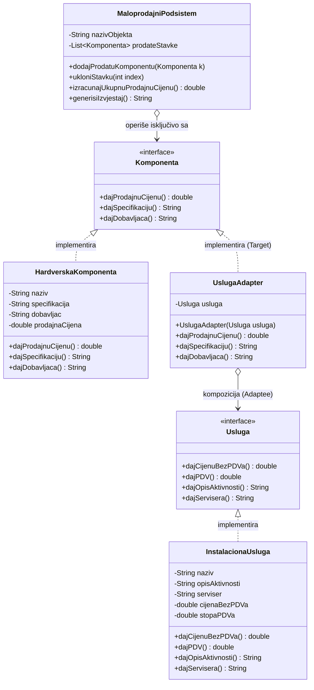

# Projekat: Maloprodajni podsistem računarske opreme (Adapter Pattern)

Ovaj projekat implementira modularni softverski sistem za praćenje poslovanja prodavnice računarske opreme u **Java Swing** okruženju, razvijen u okviru predmeta **Softverski Paterni / Projektovanje softvera**.

Arhitektura sistema oslanja se na strukturni projektni uzor **Adapter (Adapter Pattern)** koji omogućava uniformno uključivanje i prikaz servisnih usluga (instalacija, održavanje) unutar postojećeg maloprodajnog podsistema koji je izvorno projektovan isključivo za rad sa hardverskim komponentama — **bez ikakvih izmena u postojećem kodu maloprodajnog podsistema**.

---

## 1. Motivacija i problem

U sistemu postoje dva nezavisno razvijena podsistema:
1. **Maloprodajni objekti (Retail)**: Prodaju hardverske komponente. Sve komponente su predstavljene interfejsom `Komponenta` (`dajProdajnuCijenu()`, `dajSpecifikaciju()`, `dajDobavljaca()`). Maloprodaja sadrži funkcionalnost generisanja izveštaja o svim prodatim artiklima sa njihovim specifikacijama i cenama.
2. **Servisna služba (Service)**: Pruža usluge sklapanja, instalacije i servisiranja računara. Sve usluge su predstavljene interfejsom `Usluga` (`dajCijenuBezPDVa()`, `dajPDV()`, `dajOpisAktivnosti()`, `dajServisera()`).

**Problem:** Kako omogućiti da se u izveštaju maloprodaje ravnopravno nađu i usluge instalacije, sa uračunatim porezom, opisom aktivnosti i serviserom, a da se pritom ne menja postojeći kod podsistema za maloprodaju niti interfejs `Komponenta`?

**Rešenje:** Primena objektnog **Adapter projektnog uzora**.

---

## 2. Primenjeni projektni uzor: Adapter (Objektni adapter)

### 2.1. Uloge u uzoru:
- **Ciljni interfejs (Target):** `komponenta.Komponenta`
  - Interfejs koji klijentski podsistem poznaje i očekuje.
- **Prilagođavani interfejs (Adaptee):** `usluga.Usluga`
  - Postojeći interfejs servisne službe čije metode nisu direktno kompatibilne sa `Komponenta`.
- **Adapter (Adapter):** `adapter.UslugaAdapter`
  - Implementira `Komponenta`, a kroz kompoziciju drži referencu na instancu `Usluga`.
  - Preslikava pozive metoda sa interfejsa `Komponenta` na odgovarajuće metode i kalkulacije interfejsa `Usluga`.
- **Klijent (Client):** `podsistem.MaloprodajniPodsistem` i `form.MainForm`
  - Radi isključivo sa interfejsom `Komponenta`.

### 2.2. Tabela preslikavanja metoda u adapteru (`UslugaAdapter`):

| Metoda ciljnog interfejsa (`Komponenta`) | Odgovarajuća implementacija / kalkulacija iz `Usluga` | Objašnjenje |
| :--- | :--- | :--- |
| **`dajProdajnuCijenu()`** | `cenaBezPDV * (1.0 + stopaPDV)` | Usluga ima cenu bez poreza i procenat PDV-a; adapter izračunava konačnu maloprodajnu cenu sa porezom. |
| **`dajSpecifikaciju()`** | `"[USLUGA INSTALACIJE] " + usluga.dajOpisAktivnosti()` | Opis servisnih radova se prikazuje na mestu gde maloprodajni izveštaj očekuje specifikaciju. |
| **`dajDobavljaca()`** | `"Serviser: " + usluga.dajServisera()` | Serviser koji izvršava radove se preslikava u dobavljača/izvršioca stavke. |

### 2.3. Dijagram klasa (UML / Mermaid):



---

## 3. Struktura projekta

```
DrugiProjekatPaterni/
├── nbproject/                          <-- NetBeans projektna konfiguracija (otvaranje i F6)
│   ├── project.xml
│   ├── project.properties
│   └── build-impl.xml
├── src/
│   ├── komponenta/
│   │   ├── Komponenta.java             <-- Target interfejs maloprodaje
│   │   └── HardverskaKomponenta.java   <-- Konkretna hardverska stavka
│   ├── usluga/
│   │   ├── Usluga.java                 <-- Adaptee interfejs servisne službe
│   │   └── InstalacionaUsluga.java     <-- Konkretna instalaciona usluga
│   ├── adapter/
│   │   └── UslugaAdapter.java          <-- Adapter koji prilagođava Usluga na Komponenta
│   ├── podsistem/
│   │   └── MaloprodajniPodsistem.java  <-- Maloprodajni podsistem (evidencija i izveštaj)
│   ├── panel/                          <-- NETBEANS JPANEL FORME (Design / Drag & Drop)
│   │   ├── FormInputPanel.java         <-- Polimorfni interfejs za ulazne panele (iz Projekta 1)
│   │   ├── KomponentaPanel.java / .form <-- NetBeans JPanel Form za hardver sa GUI Designerom
│   │   └── UslugaPanel.java / .form     <-- NetBeans JPanel Form za usluge sa GUI Designerom
│   ├── form/
│   │   └── MainForm.java / .form       <-- NetBeans JFrame Form (glavna forma sa GUI Designerom)
│   └── main/
│       └── Main.java                   <-- Glavna ulazna tačka programa
├── test/
│   └── adapter/
│       └── AdapterTest.java            <-- Automatski test kalkulacije i integracije
├── dist/
│   └── DrugiProjekatPaterni.jar        <-- Gotov kompajliran JAR arhiv
├── build.xml                           <-- Ant skripta
├── manifest.mf
└── README.md
```

---

## 4. Korisnički interfejs (Swing GUI)

Aplikacija poseduje moderan i intuitivan grafički interfejs:

1. **Unos hardverskih artikala:**
   - Direktno kreiranje instance `HardverskaKomponenta` sa nazivom, specifikacijom, dobavljačem i cenom.
2. **Unos instalacionih usluga (kroz Adapter):**
   - Unos naziva usluge, opisa aktivnosti, servisera, cene bez PDV-a i stope PDV-a (npr. 20%).
   - Klikom na dugme instancira se `InstalacionaUsluga`, a zatim se automatski omotava u `UslugaAdapter` i dodaje u maloprodajni podsistem.
3. **Prikaz i tabela izveštaja (`JTable`):**
   - Pregled svih stavki sa automatskim proračunom ukupnog broja i sume prometa.
   - Kolona „Tip stavke“ jasno ilustruje da li je stavka izvorna `Hardverska komponenta` ili adaptirana `Usluga (Adapter)`.
4. **Zvanični tekstualni izveštaj:**
   - Klikom na dugme „Prikaži zvanični izveštaj“ otvara se formatirani prikaz izveštaja sa datumom, kolonama i zaglavljem.
5. **Dugme „Učitaj demo podatke“:**
   - Jednim klikom popunjava tabelu mešovitim stavkama (procesor, grafička karta, SSD, sklapanje računara, instalacija sistema, čišćenje i pasta) radi brze demonstracije profesoru/asistentu.

---

## 5. Pokretanje projekta

### Zahtevi:
- **Java SE Development Kit (JDK):** verzija 17 ili novija (podržava i najnoviji JDK 25)
- **NetBeans IDE** (ili IntelliJ IDEA / Eclipse)

### Pokretanje iz NetBeans IDE:
1. Otvorite NetBeans i izaberite **File** -> **Open Project**.
2. Odaberite folder `DrugiProjekatPaterni`.
3. Pritisnite **F6** (ili zelenu ikonicu **Run Project**).

### Pokretanje iz komandne linije (JAR):
U folderu `DrugiProjekatPaterni` pokrenite:
```bash
java -jar dist/DrugiProjekatPaterni.jar
```

### Pokretanje automatskog testa:
```bash
java -cp "build/classes;build/test/classes" adapter.AdapterTest
```
